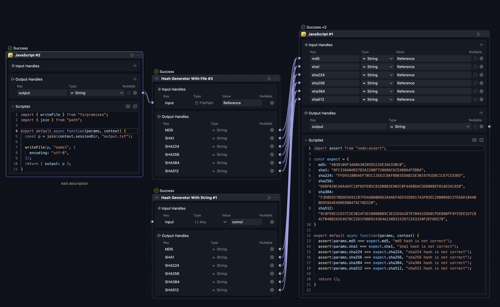

# Hash Generator

🔐 A powerful and easy-to-use hash generator for OOMOL platform that supports multiple hash algorithms.

## Overview

Hash Generator is an OOMOL package that provides secure hash generation for both text strings and files. It supports the most commonly used hash algorithms including MD5, SHA-1, and the entire SHA-2 family (SHA-224, SHA-256, SHA-384, SHA-512).

## Features

- **Multiple Hash Algorithms**: Generate MD5, SHA-1, SHA-224, SHA-256, SHA-384, and SHA-512 hashes
- **Dual Input Support**: Process both text strings and files
- **Case Control**: Choose between uppercase and lowercase hash output
- **File Safety**: Efficient file processing with chunk-based reading
- **Easy Integration**: Simple drag-and-drop blocks for OOMOL workflows

## Available Blocks

### 1. Hash Generator With String

Generate hash values from text input.

**Inputs:**
- `input`: The text string to hash
- `lowercased`: Whether to output hash in lowercase (default: false, outputs uppercase)

**Outputs:**
- `MD5`: MD5 hash value
- `SHA1`: SHA-1 hash value  
- `SHA224`: SHA-224 hash value
- `SHA256`: SHA-256 hash value
- `SHA384`: SHA-384 hash value
- `SHA512`: SHA-512 hash value

**Example Usage:**
- Input: "Hello World"
- Output (uppercase): MD5: "B10A8DB164E0754105B7A99BE72E3FE5"
- Output (lowercase): MD5: "b10a8db164e0754105b7a99be72e3fe5"

### 2. Hash Generator With File

Generate hash values from file content.

**Inputs:**
- `input`: File path (use file picker widget)
- `lowercased`: Whether to output hash in lowercase (default: false, outputs uppercase)

**Outputs:**
- `MD5`: MD5 hash value of the file
- `SHA1`: SHA-1 hash value of the file
- `SHA224`: SHA-224 hash value of the file
- `SHA256`: SHA-256 hash value of the file
- `SHA384`: SHA-384 hash value of the file
- `SHA512`: SHA-512 hash value of the file

**Example Usage:**
- Input: Select any file using the file picker
- Output: All six hash algorithms applied to the file content

## How to Use

### In OOMOL Workflows

1. **Add the Block**: Drag either "Hash Generator With String" or "Hash Generator With File" block into your workflow
2. **Configure Input**: 
   - For string: Enter your text in the input field
   - For file: Click the file picker to select a file
3. **Set Format**: Toggle the "lowercased" option based on your preference
4. **Connect Outputs**: Use any of the six hash outputs in subsequent blocks
5. **Run**: Execute your workflow to generate the hashes

### Common Use Cases

- **File Integrity Verification**: Generate checksums to verify file integrity
- **Security Applications**: Create hash values for password storage or data verification  
- **Data Deduplication**: Use hashes to identify duplicate content
- **Digital Forensics**: Generate file fingerprints for investigation
- **Backup Verification**: Ensure backup files match original files

## Hash Algorithm Information

| Algorithm | Output Length | Security Level | Common Use Cases |
|-----------|---------------|----------------|------------------|
| MD5 | 32 characters | Low (deprecated for security) | File integrity, non-security checksums |
| SHA-1 | 40 characters | Low (deprecated for security) | Legacy systems, Git commits |
| SHA-224 | 56 characters | High | Secure applications with size constraints |
| SHA-256 | 64 characters | High | Most secure applications, cryptocurrencies |
| SHA-384 | 96 characters | High | High-security applications |
| SHA-512 | 128 characters | High | Maximum security applications |

## Technical Details

- **Performance**: Files are processed in 8KB chunks for memory efficiency
- **Encoding**: Text strings are UTF-8 encoded before hashing
- **File Support**: Works with files of any size and type
- **Error Handling**: Robust error handling for file access issues

## Installation

This package is designed for the OOMOL platform. Simply install it through the OOMOL package manager and start using the blocks in your workflows.

## Screenshot

## Repository

- **GitHub**: [https://github.com/BlackHole1/oomol-hash-generator](https://github.com/BlackHole1/oomol-hash-generator)
- **Version**: 0.0.1
- **License**: Check repository for license information

## Support

For issues, feature requests, or contributions, please visit the GitHub repository or contact the OOMOL community.

---

*Built for OOMOL Platform - Making hash generation simple and accessible for everyone.*
